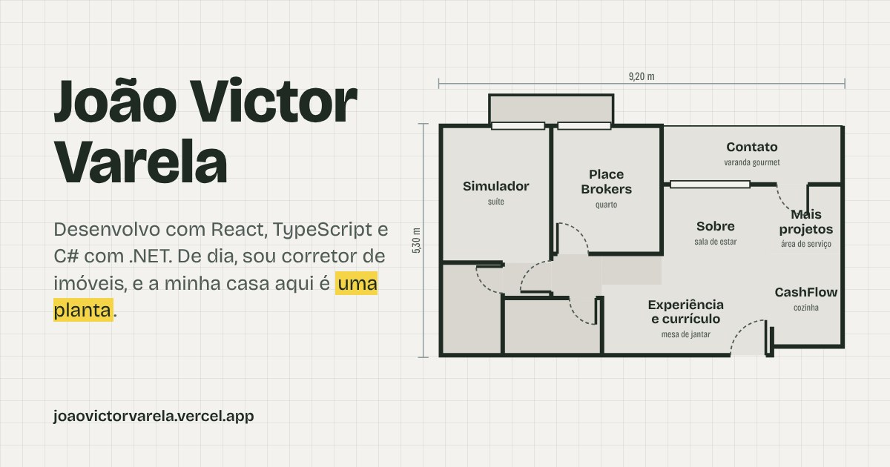

# Portfólio de João Victor Varela

Meu site pessoal: quem eu sou, o que eu construí e como falar comigo.

**[joaovictorvarela.vercel.app](https://joaovictorvarela.vercel.app)**



## A ideia do visual

Além de estudar Sistemas para Internet, eu trabalho como corretor de imóveis e mostro plantas de lançamentos aos clientes todo dia. Por isso a home é a planta de um apartamento: cada cômodo leva a uma parte do site (Projetos, Sobre, Experiência, Currículo e Contato), e o cômodo fica amarelo ao passar o mouse, como o marca-texto que o corretor usa para destacar a unidade do cliente.

As outras páginas seguem a mesma linguagem: paredes em grafite, linhas de cota separando as seções e a fonte Archivo, larga nos títulos e estreita nas legendas.

As paredes se desenham uma vez quando a página abre, e a porta de cada cômodo abre quando ele recebe o mouse ou o foco do teclado. Nas outras páginas, a linha de cota se mede ao abrir e o marca-texto passa nos números mais importantes. Tudo em CSS, sem biblioteca de animação, e desligado para quem ativou a opção de reduzir movimento no sistema.

## Páginas

- **Home:** a planta do site e um resumo do que estou fazendo agora
- **Projetos:** Simulador de Financiamento e Place Brokers em destaque, mais CashFlow, Currículo Express e EcoCiclo
- **Sobre:** minha história, formação, tecnologias e contato
- **Experiência:** linha do tempo profissional
- **Currículo:** PDF de uma página, para baixar. A fonte está em `curriculo/curriculo.html`; para gerar o PDF de novo, abra o arquivo no Chrome e use Imprimir > Salvar como PDF (sem cabeçalho e rodapé)

## Tecnologias

- Next.js 16 (App Router)
- React 19
- Tailwind CSS 4
- Fonte Archivo, instalada com Fontsource (sem depender do Google Fonts no build)
- Publicado na Vercel

## Como rodar

```bash
npm install
npm run dev
```

Depois é só abrir http://localhost:3000.

## Contato

- LinkedIn: [linkedin.com/in/joaovictorvarela](https://www.linkedin.com/in/joaovictorvarela)
- GitHub: [github.com/Jonqry](https://github.com/Jonqry)
- E-mail: joaovictorvarela321@gmail.com
