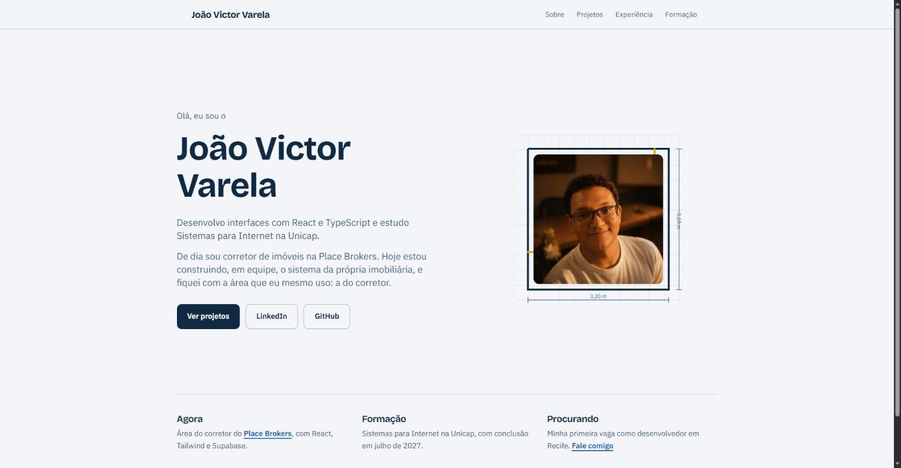

# Portfólio – João Victor Varela

Meu site pessoal: quem eu sou, o que eu construí e como falar comigo.

🔗 **[joaovictorvarela.vercel.app](https://joaovictorvarela.vercel.app)**



## A ideia do visual

Além de estudar Sistemas para Internet, eu trabalho como corretor de imóveis e lido todo dia com lançamentos vendidos ainda na planta. Por isso a home trata a minha foto como um cômodo de planta baixa: as paredes se desenham e as medidas aparecem quando a página abre.

A animação acontece uma vez só e é desligada para quem ativou a opção de reduzir movimento no sistema.

## Páginas

- **Home:** apresentação e links de contato
- **Sobre:** minha história, as tecnologias que uso e contato
- **Projetos:** Place Brokers, CashFlow, Currículo Express e EcoCiclo
- **Experiência:** linha do tempo profissional
- **Formação:** Unicap e cursos

## Tecnologias

- Next.js 16 (App Router)
- React 19
- Tailwind CSS 4
- Fontes Bricolage Grotesque e IBM Plex Sans com `next/font`
- Publicado na Vercel

## Como rodar

```bash
npm install
npm run dev
```

Depois é só abrir http://localhost:3000.

## Contato

- LinkedIn: [linkedin.com/in/joaovictorvarela](https://www.linkedin.com/in/joaovictorvarela)
- GitHub: [github.com/Jonqry](https://github.com/Jonqry)
- E-mail: joaovictorvarela321@gmail.com
